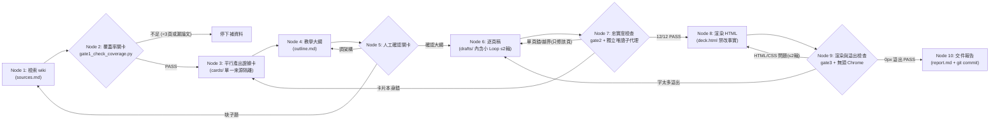

# [學校] [學號] [系級] [姓名] 用 LLM Wiki 與 Graph Workflow 打造 KV Cache Reuse 教學簡報

> *(繳交前請將上方標題方括號處改為你的「學校 學號 系級 姓名」，並於推送 GitHub 後填入實際連結)*

---

## 一、LLM Wiki 主題與簡短介紹

- **主題**：**KV Cache Reuse（大型語言模型 KV 快取重用技術）**
- **簡短介紹**：
  在長上下文 RAG、多輪對話、多代理協作（MAS）與多模型路由場景中，Prefill 階段的重複計算是延遲（TTFT／ITL）與算力成本的核心瓶頸。本專案以「**先討論、後生成**」模式，先請 AI 進行 9 題需求訪談並確認需求摘要後，才建立規則檔 `AGENTS.md`（3,231 字元，遠低於 12,000 字元上限，並附 `CLAUDE.md` 僅寫 `@AGENTS.md`、不建衝突的 `GEMINI.md`）與知識庫骨架，再依技術演進順序**一次一篇**增量 Ingest 以下 5 篇代表性論文（每篇獨立 `git commit`）：
  1. **CacheBlend**（`arXiv:2405.16444v3`，EuroSys '25）— RAG 多區塊非前綴融合與 HKVD 選擇性重算
  2. **DroidSpeak**（`arXiv:2411.02820v3`，2024／NSDI '26）— 同底模微調模型間的連續層選擇性重算共享
  3. **LMCache**（`arXiv:2510.09665v2`，2025）— 企業級分散式 KV Cache 層、卸載與 PD 分離
  4. **RelayCaching**（`arXiv:2603.13289v1`，2026）— 多代理系統 Decode-to-Prefill U 型中層與稀疏修正
  5. **Cross-Model KV Cache Transfer**（`arXiv:2608.03893v1`，NVIDIA，2026）— 同家族跨尺寸模型的閉式線性 Ridge 映射與 MLP 救援
- **知識庫特色與特別考量的事情**：
  - **讀者雙軌設計**：`wiki/` 偏向研究深度（完整公式、架構細節與實驗數據），下游 HTML 簡報則偏直覺導讀（先講為什麼與案例類比，再呈現核心機制）。
  - **嚴格唯讀邊界與章節級出處**：`raw/` 搭配 `MANIFEST.sha256` 鎖定唯讀；所有 `wiki/` 頁面強制具備 YAML Frontmatter 與章節／圖表／頁碼級引用（例：`[CacheBlend, §7.2, Fig. 12, p.12]`）。
  - **跨文獻張力不選邊站**：當不同論文前提或結果出現落差（例如 CacheBlend 在靜態 RAG 近乎無損，但在 RelayCaching 動態多代理場景明顯掉點），統一以 `⚠️ 跨文獻張力／差異` 並陳雙方實驗條件，並集中彙整於 `wiki/syntheses/conflicts-and-tensions.md`。

---

## 二、成果連結

- **LLM Wiki 成果連結**：`<請填入你的 GitHub Repo 連結，例如 https://github.com/<你的帳號>/kv-cache-reuse-wiki>`
  - 核心入口：`AGENTS.md`、`wiki/index.md`、`wiki/overview.md`、`wiki/log.md`
  - 完整結構：共 **18 個 Markdown 頁面**（5 篇 `papers/` + 5 篇 `concepts/` + 3 篇 `entities/` + 2 篇 `syntheses/` + `overview.md` / `index.md` / `log.md`）與 12 次漸進式 `git commit`。
- **教學型 HTML 簡報連結**：`<請填入 GitHub Pages 連結，例如 https://<你的帳號>.github.io/kv-cache-reuse-wiki/topic-kv-cache-reuse/deck.html>`
  - 共 **12 頁**，採「痛點直覺（Prefill vs Decode）→ 三軸演進地圖 → 五大里程碑逐篇導讀 → RoPE 與誤差落點隱藏主線 → 四大跨文獻張力 → 五大場景實務選型」的教學結構；支援 `←`/`→`/`Space` 翻頁、`G` 鍵總覽網格、進度條與列印 PDF，每頁皆附對應 `wiki/` 與章節出處頁尾。

---

## 三、Graph（內含局部 Loop）Workflow 設計說明

本專案採用 **Graph 決定大流程與退回路線、Loop 負責單一節點內反覆修正** 的設計（完整規格定義於 `.agents/workflows/topic-slides.md`），所有中介狀態都落地成檔案（`topic-kv-cache-reuse/`），每一道檢查關卡皆由可執行 Python 腳本或獨立唯讀子代理把關：

### 1. 哪些步驟會重複執行？
- **Wiki 端**：每次新增論文時重複執行「單篇 Ingest → 更新跨文獻概念／綜合頁 → 跑 `scripts/lint_wiki.py` → `git commit`」。
- **簡報端（小 Loop）**：Node 6（寫逐頁稿 → `gate2_check_drafts.py` 檢核出處與字數 → 修該頁，最多 2 輪）、Node 7（獨立子代理退回單頁 → 僅重修該頁並複審）、Node 8–9（渲染 HTML → `gate3_check_html.py`＋無頭 Chrome 測溢出 → 修正後再測，最多 2 輪）。

### 2. 哪些地方需要檢查或重新生成？
- **Node 2（`gate1_check_coverage.py`）**：檢查檢索頁數 ≥ 3、是否 100% 落在 `wiki/` 邊界內、是否涵蓋全部 5 篇論文；不足直接停止，避免拿殘缺資料硬湊。
- **Node 5（人工確認關卡）**：在寫逐頁稿之前先請人審閱 `outline.md`，若發現缺子題或敘事順序不順，趁成本最低時退回 Node 1 或 Node 4。
- **Node 7（`gate2_check_drafts.py` ＋ 獨立唯讀子代理）**：腳本先驗證每頁出處、數字是否存在於引用卡片、以及字數密度上限（≤ 950 字）；再開啟**全新獨立唯讀子代理**（不能自審自稿、也不能改檔案），只給 `drafts/` 與 `cards/`/`wiki/` 逐頁稽核忠實度與覆蓋率。不通過只退回重寫出錯那一頁。
- **Node 9（`gate3_check_html.py` ＋ `check_overflow_headless.py`）**：腳本檢查頁數一致、頁尾出處存在、且 HTML 不可私自新增逐頁稿未出現的數字；再以真實無頭 Chrome（`1280×720`）量測每頁水平／垂直溢出與頁尾重疊像素。

### 3. 為什麼這樣設計？
- **權限隔離避免幻覺與漂移**：每張證據卡只能看單一 `wiki/` 頁、每份逐頁稿只能看綁定卡片、HTML 渲染不能改動已通過的事實文字，大幅減少跨論文張冠李戴。
- **「做完了」由腳本說了算，且大圈很少轉、小圈轉得快**：用自動化腳本取代口頭「檢查一下」，並把錯誤盡量在最上游攔截，避免做到最後才整份重來。

---

## 四、一次實際執行的結果與檢查紀錄

1. **Wiki Lint 驗證（`python scripts/lint_wiki.py`）**：**9/9 PASS（0 錯誤、0 警告）**
   - `AGENTS.md` 3,231／12,000 字元、無 `GEMINI.md` 衝突、`CLAUDE.md` 正確指向 `@AGENTS.md`。
   - `raw/` 5 份來源通過 SHA-256 唯讀校驗；18 頁零斷鏈、零孤島；5 處跨文獻張力全部收錄於 `conflicts-and-tensions.md`。
2. **Gate 1 覆蓋率檢查（`gate1_check_coverage.py`）**：**PASS**（有效 `wiki/` 頁面 16 頁、5/5 論文全覆蓋）。
3. **Node 5 人工確認大綱**：審閱 12 頁大綱與證據卡綁定後核准放行。
4. **Gate 2 ＋ 獨立唯讀子代理忠實度審查（真實退回與修正紀錄）**：
   - `gate2_check_drafts.py`：**PASS**（12 頁、0 錯誤、0 警告）。
   - **獨立子代理 Round 1 裁決：`FAIL`（精準抓出 2 頁退件 + 5 頁微調）**：
     - `slide-04.md`：寫入「Messi **世界盃**進 13 球」，但卡片與 Wiki 僅寫「Messi 進 13 球」，抓出外部常識溢漏！
     - `slide-09.md`：「**只要**屬同家族且 Matched-KV…竟具高度線性結構」過度陳述充分條件（遺漏 `dense full-attention` 且與 Tier 2 失敗矛盾），且 `278 ms vs 6,975 ms = 25×` 緊接在 Llama 3.1 後方未標明係屬 `Qwen3 14B→32B`。
   - **執行 Graph 退回路線**：保持其餘 5 頁 `PASS` 頁完全不動，僅退回修正受影響頁面 → 重跑 `gate2` 0 錯誤 → 交回獨立子代理 **Round 2 複審：`12/12 PASS`，零殘留缺陷**。
5. **Gate 3 ＋ 無頭 Chrome 版面實測（第二次真實攔截紀錄）**：
   - **`gate3_check_html.py` Round 1 裁決：`FAIL`**：抓出 Slide 1 眉標美化時多寫了逐頁稿未出現的 `100%`（`Slide 1: Metric '100%' in HTML is NOT present in approved draft slide-01.md`）。修正眉標後 Round 2 **0 錯誤 PASS**。
   - **無頭 Chrome `1280×720` 實測（`check_overflow_headless.py`）**：全部 12 頁皆 **`hOverflow=0px, wOverflow=0px, footerOverlap=0px [PASS]`**。

---

## 五、反思

### 1. 哪一個節點最常出錯？
實測下來，**Node 6「逐頁稿撰寫」與 Node 8「HTML 渲染」的邊界最容易出錯**，而且錯的不是明顯亂寫，而是「看似合理但越界」的隱性錯誤：
- 在 Node 6 寫教學白話稿時，AI 容易不知不覺補進預訓練記憶裡的背景字詞（如 `slide-04` 多寫了卡片沒寫的「世界盃」），或在壓縮字數時把限定前提與數據所屬模型省略掉（如 `slide-09` 的 `dense full-attention` 與 `Qwen3 14B→32B`）。
- 在 Node 8 寫 HTML 視覺元素時，AI 為了讓封面眉標更有力，順手加了逐頁稿沒有的 `100%`，違反了「排版節點不可改動事實／數字」的鐵律。

### 2. 發現問題後，把檢查往前移到了哪一個步驟？
- **把「防版面溢出」從 Node 9 往前移到 Node 6/7**：原本溢出都要等到 HTML 畫完才發現並大修，我們在 `gate2_check_drafts.py` 就先強制驗證單頁字數密度上限（≤ 950 字），結果進到 Node 9 無頭 Chrome 實測時 12 頁一次就達成全部 `0px` 溢出，完全沒發生「從最後一關退回起點轉大圈」的慘況。
- **把「前提條件與數據模型歸屬」從 Node 7 往前移到 Node 3（證據卡）**：原本要靠 Node 7 獨立子代理事後抓出 `slide-09` 的過度概括與模型混淆；實測後我們把這項要求提前寫進 Node 3 證據卡規則——每張卡片在抽取階段就強制明列「適用前提／限制」與「每項數據綁定的模型與基準」，讓下游 Node 6 根本不容易寫歪。

### 3. 有沒有因此修改 workflow / graph？為什麼？
**有，做了兩項具體修改並以 Git 紀錄保留**：
1. **升級 Node 3 證據卡規範（`.agents/workflows/topic-slides.md`）**：新增「每張卡須明列適用前提／限制與每項數據綁定之模型／基準」，從源頭減少 Node 6 撰寫逐頁稿時的概括誤差與歸屬歧義。
2. **將 Node 9 的「渲染溢出檢查」實質腳本化（新增 `scripts/check_overflow_headless.py` 與 `deck.html?audit=1` 鉤子）**：原本 Workflow 只寫了「實際瀏覽器溢出檢查」，實際執行後我們直接把它做成可重複執行的無頭 Chrome 像素量測腳本，搭配 `gate3_check_html.py` 的「禁止新增未授權數字」驗證，真正落實「說檢查一下不算驗證，腳本說了算」。
