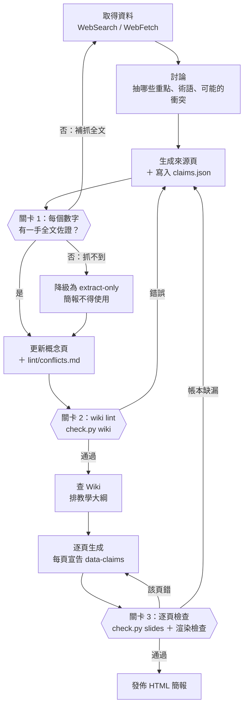

# Loop / Graph 設計（v2）

## 流程圖

重複執行的迴圈有兩個：
- **ingest 迴圈**：每一篇來源都走一次 A → B → C → 關卡 1（共 6 篇）。
- **生成迴圈**：每一頁走一次 F → 關卡 3（共 22 頁），不通過就只退回那一頁。

## 各節點在做什麼
| 節點 | 做什麼 | 輸出 |
|---|---|---|
| 取得資料 | 用搜尋找來源，再抓全文 | 原文（或工具擷取摘要） |
| 討論 | 寫入前先決定：這篇要抽什麼、會跟哪些頁面衝突、術語怎麼處理（先討論、後生成） | `log.md` 的「討論」欄 |
| 生成來源頁 | 只記來源自己說的；每個主張一個 claim id | `sources/*.md`、`claims.json` |
| 關卡 1 | 數字是否在「已抓取的一手全文」找得到；找不到就標 `extract-only` | claim 的 `status` |
| 更新概念頁 | 把 claim 組成給初學者讀的概念頁，每句標 `[C##]` | `concepts/*.md` |
| 關卡 2 | `tools/check.py wiki`：引用的 claim 都存在、帳本沒有孤兒、帶數字的事實行有標註 | 錯誤／警告清單 |
| 查 Wiki、排大綱 | 只用 Wiki 裡的 claim 排出教學順序 | 22 頁大綱 |
| 逐頁生成 | 每頁 `data-claims` 寫明依據；沒依據的頁面標 `none`（純解說） | `deck.html` |
| 關卡 3 | `tools/check.py slides`：每頁數字必須在引用 claim 的 `numbers` 內，且不得引用 extract-only；再用瀏覽器逐頁檢查溢出 | 錯誤清單 |

## 為什麼這樣設計
1. **錯誤在 ingest 就會產生，不是在寫簡報時才產生。** 來源之間、搜尋摘要與全文之間的數字會不一致。如果等簡報寫完才檢查，已經分不清錯是誰造成的，所以第一道關卡放在「寫進 Wiki 之前」。
2. **簡報只能引用帳本。** 簡報的每個數字都能追到 claim、來源與驗證狀態；這讓「Wiki 與簡報的對應」是可以機械檢查的，而不是口頭保證。
3. **不通過只退回最小單位。** 一頁出錯只重生成那一頁；帳本缺漏才退回 ingest。這樣修一個錯不會讓整份簡報重來。
4. **機械檢查與人工檢查分工。** `check.py` 只能檢查「數字有沒有來源」，不能檢查「句子的意思有沒有講歪」，所以意思的部分仍要人工抽查，見 `logs/run-001.md` 的限制。
